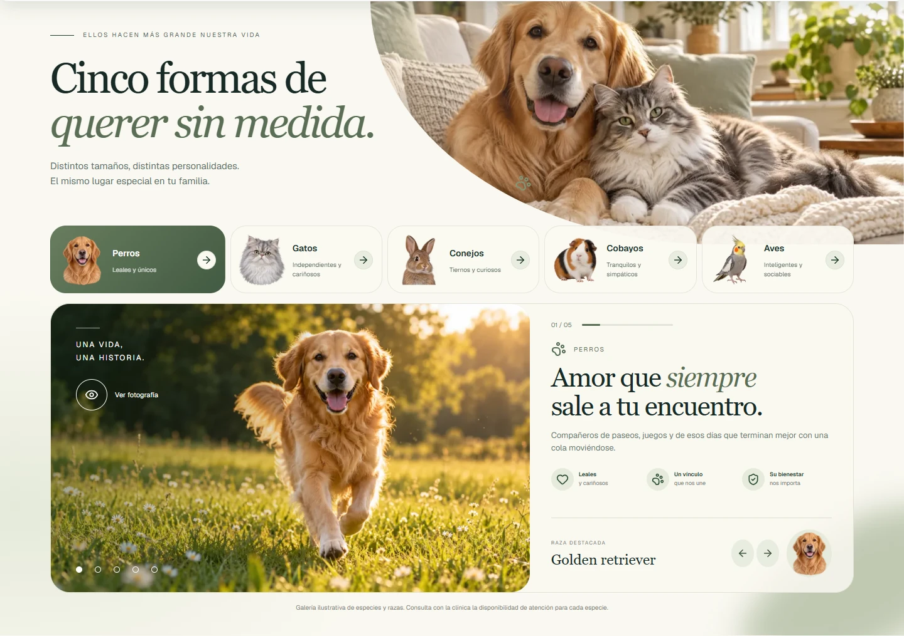
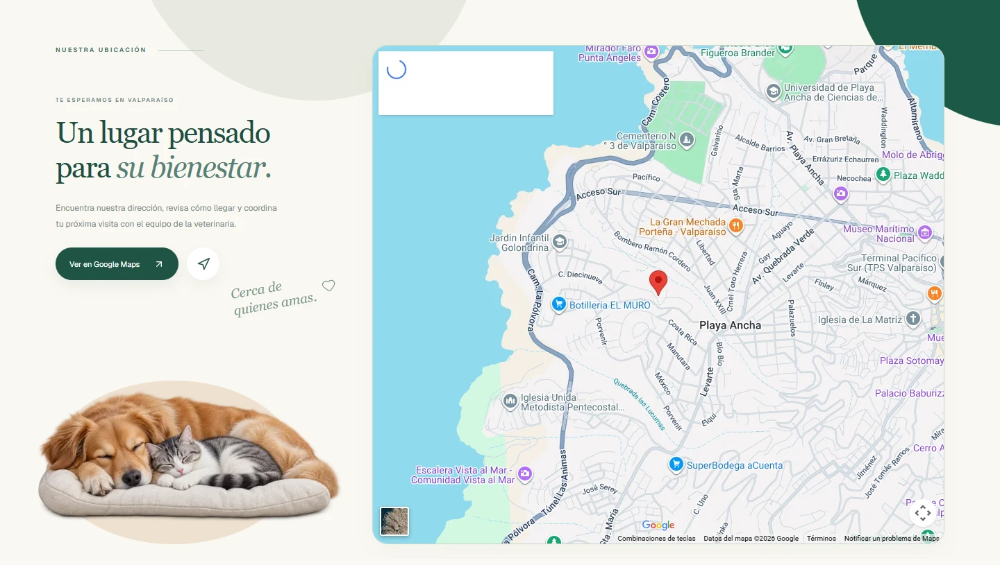
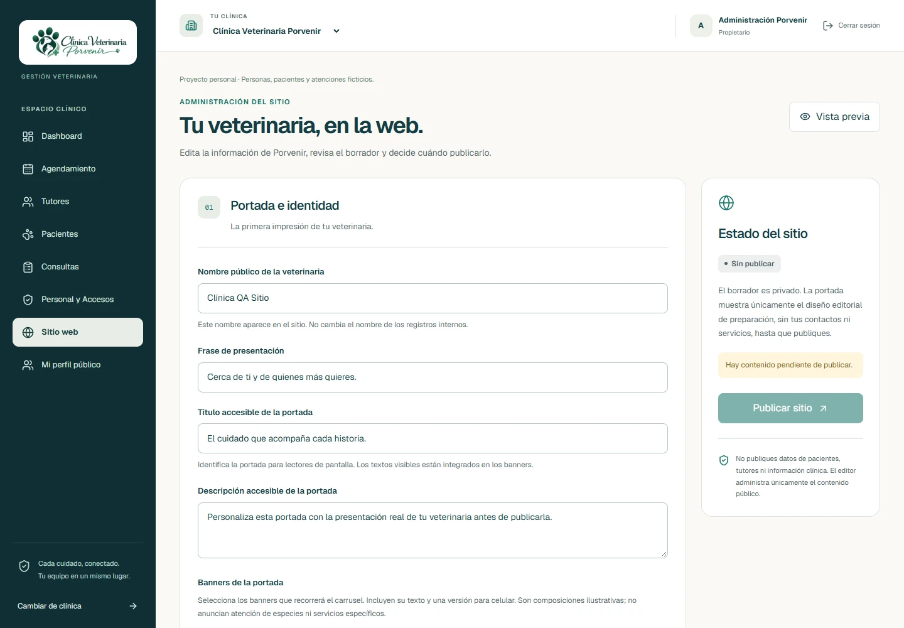
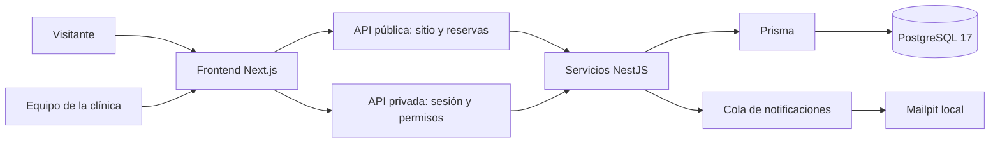

# Pawly

> Proyecto 03 | [Project-03-Pawly-Octubre-2026](https://github.com/koyarxs/Project-03-Pawly-Octubre-2026)

Pawly es un proyecto personal de sitio veterinario autoadministrable y gestión interna, construido con Next.js, NestJS, Prisma y PostgreSQL. Incluye autenticación, personal, agenda, tutores, pacientes, consultas e historia clínica, con datos y permisos aislados por clínica. El sitio público corresponde a **Clínica Veterinaria Porvenir**. No hay contratación ni administración de suscripciones implementada.

Modalidad actual: **proyecto personal con datos ficticios**. La clínica Porvenir · DEMOSTRACIÓN permite probar reservas y gestión de citas localmente, sin contratar dominio, hosting ni correo. Incluye 12 servicios, tres profesionales ficticios, ocho tutores, ocho mascotas y siete escenarios de citas. La cuenta propietaria puede ensayar los estados con permisos simulados exclusivos del tenant local; no se verifican credenciales ficticias ni se habilita esa autoridad en producción. [Guía de demostración](docs/appointments-demo.md) y [verificaciones](docs/appointments-progress.md).

## Contenido

- [Recorrido visual](#recorrido-visual)
- [Estado actual](#estado-actual)
- [Guía detallada de funcionalidades](#guía-detallada-de-funcionalidades)
- [Tecnologías](#tecnologías)
- [Arquitectura, datos y seguridad](#arquitectura-datos-y-seguridad)
- [Estructura](#estructura)
- [Ejecutar en desarrollo](#ejecutar-en-desarrollo)
- [Validaciones](#validaciones)
- [Capturas y documentación reproducible](#capturas-y-documentación-reproducible)
- [Próximos pasos](#próximos-pasos)
- [Recursos y seguridad](#recursos-y-seguridad)

## Recorrido visual

Las **22 capturas** de este README se tomaron desde la aplicación funcionando, no desde maquetas. Las públicas corresponden al sitio local de Porvenir. Las privadas utilizan Next.js, NestJS y PostgreSQL reales, con un esquema temporal y datos exclusivamente ficticios. Los nombres, atenciones y métricas no representan una veterinaria en operación.

Las capturas de escritorio parten de 1440 × 1000 y la móvil de 390 × 844. Se guardan como WebP dentro del repositorio; pueden abrirse para consultar los detalles.

### Sitio público de Porvenir


### Dashboard privado

Esta captura tiene ocho pacientes, ocho tutores y una consulta ficticia en borrador. Las citas de hoy son cero porque los ejemplos se crearon para una fecha posterior: los indicadores provienen de la API, no de cifras añadidas a la imagen.


## Estado actual

Actualizado: **24 de octubre de 2026**. Alcance del sitio: [Porvenir](docs/porvenir-site.md). Roles, cargos y perfiles públicos: [Personal y Accesos](docs/staff-access.md).

El estado se describe por funcionalidades verificables, sin porcentajes de avance. Contratos y pruebas: [gestión clínica](docs/clinical-records.md) y [agenda](docs/appointments.md) y [consultas e historia clínica](docs/consultations.md).

| Área | Implementado | Pendiente |
| --- | --- | --- |
| Sitio público | Portada con carrusel, galería de mascotas, perfiles del equipo, testimonios ilustrativos, mapa, footer y marca Porvenir | Continuar ajustes de contenido y accesibilidad |
| Administración web | Borrador, vista previa privada, publicación y retirada por propietario/administración | Carga de archivos propios y versiones históricas de contenido |
| Personal y Accesos | Invitaciones por enlace, cargos, permisos efectivos, suspensión, revisión manual de credenciales, auditoría y perfiles publicados con consentimiento | Correo externo para invitaciones y retratos propios |
| Agendamiento público | Servicios, médico con miniatura, disponibilidad real, solicitud, comprobante privado, reprogramación y cancelación | Personalizar los datos ficticios desde la administración |
| Agenda interna | Vistas diaria, semanal y mensual; filtros, estados, historial, horarios, excepciones y prevención de solapamientos | Ampliaciones según retroalimentación |
| Boletín y notificaciones | Registro con consentimiento y acuses locales; cola de notificaciones de reservas y recordatorios con Mailpit | Campañas, confirmación de correo y baja pública |
| Frontend | Sitio de Porvenir, acceso privado, dashboard con datos reales y módulos clínicos con diseño compartido | Vacunación, inventario y reportes |
| Backend | NestJS modular, sesiones, permisos, gestión clínica y contenido público separado de los borradores | Correo verificado y recuperación de contraseña |
| Persistencia | PostgreSQL 17, Prisma, migraciones versionadas y FK multi-clínica | Respaldos y operación de producción |
| Calidad | TypeScript, ESLint, builds, unitarias, integración PostgreSQL y Playwright | CI/CD, despliegue y cobertura de módulos futuros |

La portada no ofrece suscripciones ni contratación. El registro de clínicas permanece disponible solo en desarrollo. El acceso privado usa datos de la API real. Guardar un borrador no modifica la publicación. Las APIs públicas excluyen borradores, datos de autenticación y registros clínicos. El equipo se publica por separado con consentimiento; los perfiles de ejemplo y sus retratos generados se identifican como ficticios.

### Agendar una cita

El botón **Agendar cita** abre `/agendar-cita`. El portal presenta fotografía veterinaria, personajes originales de Pawly con animación suave y accesos rápidos a los servicios configurados. El flujo permite elegir servicio, profesional, fecha y hora, ingresar datos del tutor y mascota y revisar la solicitud. La selección de profesionales respeta los servicios asignados; no ofrece la opción «Sin preferencia».

Los horarios se consultan en PostgreSQL y se vuelven a validar al reservar. Las fechas se almacenan en UTC y se muestran según la zona de la clínica, inicialmente `America/Santiago`. La reserva entrega una referencia y clave privada para consultar, reprogramar o cancelar; el portal no busca fichas clínicas por correo. La confirmación de una solicitud y su vinculación a pacientes/tutores existentes se realizan desde el espacio privado con los permisos correspondientes.

En el proyecto local se incluyen 12 servicios editables, tres médicos ficticios con retratos distintos y horarios de ejemplo. El administrador puede configurar servicios, duraciones, asignaciones, horarios individuales y excepciones sin modificar código. Los perfiles ficticios no acreditan credenciales ni se habilitan para producción. [Funcionamiento y pruebas de agenda](docs/appointments-progress.md).

### Correo local y reseñas

Mailpit permite revisar los mensajes de prueba en **http://localhost:8025**, sin entregarlos a direcciones externas. El boletín registra solicitudes con consentimiento y genera acuses locales; no implementa campañas de novedades. La configuración predeterminada mantiene el correo desactivado. [Configuración del boletín](docs/newsletter.md).

Las reseñas de ejemplo se distinguen de las reseñas reales. La integración opcional con Google requiere una ficha y configuración propia del servidor; no se activa al clonar el repositorio. [Reseñas y estados disponibles](docs/google-reviews.md). El chatbot de IA fue retirado y no forma parte de la aplicación activa; se conserva su migración histórica para mantener la secuencia de la base.

## Guía detallada de funcionalidades

### Sitio público, marca y experiencia visual

La landing pasó de una presentación genérica de comercialización SaaS a un sitio para Clínica Veterinaria Porvenir. Se trabajaron logo, navegación, fotografías, tipografía, colores, tarjetas, composición responsive y coherencia con el espacio privado.

- Carrusel de portada con cambios de imagen y controles.
- Accesos a iniciar sesión y agendar una cita.
- Galería por especie y ampliación centrada de fotografías.
- Cinco grupos de compañeros: perros, gatos, conejos, cobayos y aves.
- Equipo con retratos diferenciados, áreas de atención y perfiles ilustrativos ampliados.
- Historias y testimonios distinguiendo ejemplos ficticios de opiniones reales.
- Ubicación con Google Maps e indicaciones para la dirección configurada.
- Footer con navegación, horario, ubicación, redes y boletín.
- Redes con colores característicos; las que no tienen enlace no se presentan como destinos activos.
- Personajes originales de Pawly y animaciones suaves con soporte de movimiento reducido.

<details>
<summary><strong>Ver galería, equipo, historias, ubicación y footer</strong></summary>

**Galería por especie**



**Presentación del equipo**

Los perfiles ilustrativos no acreditan trabajadores reales ni habilitan automáticamente a una persona para atender o reservar.


**Historias y testimonios**


**Ubicación**



**Footer y boletín**


</details>

### Autenticación y navegación privada

Las cuentas tienen sesiones y membresías por clínica. El navegador no se concede un rol ni sustituye la autorización del servidor. El acceso incluye inicio/cierre de sesión, selección de clínica, comprobación de membresía activa, expiración y revalidación de permisos. Si la revalidación no cambia el acceso efectivo, se conserva el formulario en curso.

El registro de clínicas está disponible en desarrollo y bloqueado públicamente en producción. Registro, recuperación y verificación de correo son procesos distintos: **todavía no hay recuperación de contraseña ni verificación de correo implementadas**.

La navegación conecta Dashboard, Agendamiento, Tutores, Pacientes, Consultas, Personal y Accesos, Sitio web y Mi perfil público. Inventario, reportes y facturación no se presentan como operativos.

<details>
<summary><strong>Ver inicio de sesión</strong></summary>

La captura se tomó con los campos vacíos, antes de utilizar credenciales temporales.


</details>

### Tutores

Cada tutor pertenece a una clínica. Una persona atendida en dos clínicas no se convierte en un registro global compartido. Se implementaron alta, consulta, edición, búsqueda, paginación, filtros por estado y consulta de mascotas asociadas.

La ficha incluye nombre, apellidos, teléfono y contacto opcional; dirección y observaciones se muestran conforme al permiso. El archivado conserva relaciones y rechaza archivar un tutor con pacientes pendientes de reasignar o archivar. No se exponen contactos a perfiles sin autorización.


### Pacientes y responsables

Un paciente puede tener uno o varios tutores activos de la misma clínica. Backend y claves foráneas compuestas validan las asociaciones. La ficha admite nombre, especie, sexo, raza, nacimiento, peso, color, microchip y notas según permisos.

Se incluyen alta, consulta, edición, búsqueda por paciente/responsable y archivado con integridad. El microchip se normaliza y es único dentro de la clínica. Se validan fechas y peso. Los roles con alcance limitado solo consultan pacientes asignados; la historia clínica requiere autorización adicional.

La API contempla perros, gatos, aves, conejos, roedores, reptiles, caballos y otras especies. Esto no afirma que Porvenir ofrezca atención para todas ellas.

<details>
<summary><strong>Ver listado y ficha de paciente</strong></summary>


</details>

### Reserva pública: de la selección al comprobante

El flujo de `/agendar-cita` y `/reservar/[clinicSlug]` se organiza en cinco pasos:

1. Servicio habilitado.
2. Médico compatible, con miniatura y área de atención.
3. Fecha y horario consultados al backend.
4. Datos de tutor, contacto, mascota y motivo.
5. Revisión, consentimiento y envío.

Una hora visible no queda reservada hasta confirmar la escritura. El servidor vuelve a comprobar duración, preparación, profesionales, franjas, bloqueos, anticipación y recursos compartidos.

La solicitud pública es distinta de la cita clínica. No se buscan fichas ni se vinculan personas por coincidencia de correo o nombre. Recepción verifica los datos y relaciona la solicitud con tutor/paciente desde el espacio privado.

El comprobante entrega referencia y clave privada para consultar, reprogramar y cancelar. Se conserva el hash de esa clave; no hay consulta pública de reservas mediante datos personales. Las capturas no muestran comprobantes con claves.


<details>
<summary><strong>Ver médicos, horarios y móvil</strong></summary>


La siguiente captura es una ventana móvil real, sin marco de teléfono añadido.


</details>

### Agenda privada y administración

Ruta: `/app/clinicas/:clinicId/agenda`.

| Pestaña | Función |
| --- | --- |
| Calendario | Vistas diaria, semanal y mensual; navegación por fechas |
| Citas del día | Jornada seleccionada |
| Próximas citas | Atenciones futuras |
| Solicitudes pendientes | Revisión, confirmación, reprogramación, cancelación y vinculación |
| Historial | Registros y cambios de estado |
| Disponibilidad | Horarios de clínica/profesionales y excepciones |
| Servicios | Duración, preparación, profesionales y recursos |
| Configuración | Políticas y mensajes por clínica |

Se implementaron creación, edición, reprogramación, cancelación conservando historial, filtros por profesional/servicio/estado y paginación. Las escrituras revalidan permisos y relaciones dentro de transacciones.

| Estado de cita | Presentación |
| --- | --- |
| `SCHEDULED` | Programada |
| `CONFIRMED` | Confirmada |
| `ARRIVED` | Llegada / en espera |
| `IN_PROGRESS` | En atención |
| `COMPLETED` | Completada |
| `CANCELLED` | Cancelada con motivo e historial |
| `NO_SHOW` | No asistió; se rechaza para citas futuras |

Las solicitudes públicas tienen otro flujo: pendiente, confirmada, vinculada, cancelada o rechazada. Una solicitud recibida no equivale a una cita confirmada. Las citas completadas, canceladas e inasistencias son terminales y las consultas vinculadas imponen sus reglas de consistencia.


**Servicios iniciales editables:**

| Servicio | Minutos referenciales |
| --- | ---: |
| Consulta veterinaria general | 30 |
| Vacunación | 20 |
| Desparasitación | 20 |
| Control médico | 30 |
| Consulta dermatológica | 40 |
| Consulta de especialidad | 45 |
| Exámenes de laboratorio | 30 |
| Ecografía | 45 |
| Radiografía | 30 |
| Procedimientos menores | 60 |
| Cirugía veterinaria | 120; confirmación previa |
| Control postoperatorio | 30 |

Se pueden crear, editar y desactivar servicios. Solo se eliminan definitivamente si lo permiten sus relaciones; la eliminación queda auditada y no borra citas para eludir restricciones.

Los horarios iniciales son lunes a viernes 09:00–14:00 y 15:00–19:00, sábado 09:00–14:00 y domingo cerrado. Son ejemplos configurables, no horarios reales. Se conservan instantes UTC, presentación IANA y validación de cambios de horario de Chile, incluyendo horas ambiguas o inexistentes.

<details>
<summary><strong>Ver servicios, disponibilidad y configuración</strong></summary>


</details>

### Consultas e historia clínica electrónica

Las consultas se inician desde una cita compatible o sin cita, con paciente y profesional autorizados. Un cargo administrativo no concede facultades médicas por sí solo.

El registro incluye motivo, fecha, profesional, autor, anamnesis, antecedentes, examen, hallazgos, diagnóstico y tipo, tratamiento, indicaciones y notas. Los signos vitales opcionales incluyen peso, temperatura y frecuencias cardíaca/respiratoria. El próximo control es un dato clínico: no genera automáticamente una cita.

El borrador se guarda explícitamente y permite edición con control de versión. Finalizar exige campos adicionales y conserva el original. Las correcciones son rectificaciones nuevas con motivo, actor y fecha. PostgreSQL protege consultas finalizadas, eventos y rectificaciones con restricciones y triggers.

La cita vinculada y su historial se actualizan en la misma transacción: borrador asociado a atención en curso y finalización asociada a cita completada. Un conflicto de versión exige recargar; no se fusionan borradores automáticamente.


### Personal, permisos y credenciales

Se distinguen identidad, rol de membresía, cargo y autorización profesional. Un texto público como «médico veterinario» no otorga acceso clínico.

| Rol | Alcance inicial resumido |
| --- | --- |
| `OWNER` | Administración y delegación de permisos críticos; sin transferencia de propiedad desde este módulo |
| `ADMIN` | Administración operativa dentro de sus capacidades |
| `CLINIC_DIRECTOR` | Gestión operativa; facultades médicas verificadas por separado |
| `VETERINARIAN` | Atención conforme a credenciales y permisos efectivos |
| `RECEPTIONIST` | Tutores, pacientes administrativos y agenda; sin historia clínica completa |
| `VET_TECHNICIAN` | Resumen administrativo y agenda de pacientes asignados |
| `PET_GROOMER` | Resumen administrativo de pacientes asignados; sin simular agenda médica de peluquería |

Concesiones, denegaciones y alcance por pacientes pueden modificar estos valores. El backend comprueba permisos efectivos al operar; ocultar botones no es el único control.

Incluye invitaciones temporales de un solo uso, activación, suspensión, asignación de pacientes, revisión de credenciales por otro usuario autorizado, publicación consentida y auditoría append-only. Las invitaciones no se envían por correo automáticamente.

El propietario tiene permisos simulados solo en el tenant ficticio configurado en desarrollo/pruebas. No se verifican esas credenciales ni se concede autoridad en producción u otras clínicas.


### Editor del sitio, boletín y notificaciones

El editor permite gestionar identidad pública, portada, fotografías disponibles, servicios, presentación, testimonios gestionados, contacto, dirección, horarios y visibilidad de secciones configurables. Incluye borrador, vista previa privada, publicación y retirada. Guardar un borrador no cambia la publicación. No hay carga libre de archivos ni gestor multimedia completo.



El boletín normaliza correos, exige consentimiento, evita duplicados y devuelve respuestas genéricas. El acuse local no equivale a campañas: faltan confirmación de propiedad del correo, baja pública y envío de novedades a la lista.

El agendamiento tiene una cola de salida transaccional para recepción, confirmación, reprogramación, cancelación y recordatorios. Utiliza claves idempotentes y omite versiones obsoletas. SMTP no garantiza exactamente una entrega ante todos los fallos entre aceptación y confirmación de la operación.

## Tecnologías

| Capa | Tecnologías |
| --- | --- |
| Frontend | Next.js 16.3.5, React 19.2.8, TypeScript 5.9.3 y Tailwind CSS 4.3.3 |
| Componentes | Radix Slot, configuración shadcn/ui, CVA, clsx y tailwind-merge |
| Iconos y animación | Lucide React 1.55.0 y Motion 14.1.0 |
| Backend | NestJS 11.2.7, TypeScript estricto, Express, ConfigModule, Joi, class-validator y class-transformer |
| Persistencia | PostgreSQL 17 Alpine y Prisma / Prisma Client 6.19.3 |
| Entorno | Node.js 24, npm, Docker y Docker Compose; las pruebas unitarias frontend utilizan transformación TypeScript de Node 24 |
| Verificación | ESLint 9, Jest, Supertest y Playwright |

Cada aplicación tiene su propio package.json y package-lock.json.

## Arquitectura, datos y seguridad

El backend es modular y no utiliza microservicios. El navegador consume APIs REST; Prisma se ejecuta en NestJS, no en los componentes del navegador.



### Modelo e integridad

La clínica es el contexto de los registros operativos. Las membresías vinculan usuarios y clínicas; tutores, pacientes, citas, consultas, personal, contenido y reservas conservan sus referencias de clínica.

- El backend valida membresía, estado y permisos; el navegador no puede concederse un rol.
- Las búsquedas y modificaciones usan la clínica autorizada.
- Las claves foráneas compuestas impiden relaciones sensibles entre clínicas.
- Transacciones y bloqueo compartido por clínica coordinan escrituras que lo requieren.
- El archivado conserva registros y relaciones en lugar de borrarlos indiscriminadamente.
- Las pruebas utilizan clínicas y esquemas propios, sin reutilizar datos personales reales.

Estos controles no equivalen a una auditoría externa ni impiden que un administrador con acceso total a PostgreSQL altere su infraestructura. La prevención de solapamientos corresponde a los servicios de la aplicación, no a una garantía frente a escrituras administrativas arbitrarias directas.

### Controles de acceso y protección

Sesiones con cookies HttpOnly, Secure en producción y SameSite=Lax; contraseñas con Argon2id; CORS, validación de origen y CSRF en escrituras correspondientes. Las entradas se validan con DTOs, fechas, límites y comprobaciones de relaciones.

Las APIs clínicas usan respuestas sin caché, errores genéricos y autorización del servidor. Las operaciones sensibles vuelven a comprobar acceso dentro de la escritura. Invitaciones y claves privadas de gestión no se guardan como secretos recuperables en texto plano.

Hay controles de versión en citas, consultas y configuración; no se presupone que todos los formularios tengan resolución de ediciones concurrentes. Las consultas finalizadas y las auditorías tienen las protecciones específicas descritas en sus documentos.

### Migraciones versionadas

| Migración | Propósito |
| --- | --- |
| `20261014000100_identity_clinics_foundation` | Identidad, clínicas y membresías |
| `20261015010000_clinical_tutors_patients` | Tutores, pacientes y relaciones |
| `20261018010000_veterinary_appointments` | Agenda e historial |
| `20261018020000_veterinary_consultations` | Consultas, versiones y rectificaciones |
| `20261021010000_veterinary_website` | Sitio autoadministrable |
| `20261022010000_clinic_staff_access` | Personal, invitaciones, permisos y auditoría |
| `20261023010000_newsletter_subscribers` | Solicitudes del boletín |
| `20261023020000_porvenir_concierge` | Tablas históricas del asistente retirado |
| `20261023040000_professional_booking` | Servicios, políticas, reservas y notificaciones |
| `20261023050000_booking_audit_actions` | Auditoría del agendamiento |

Las migraciones aplicadas no se editan. En la instalación local se aplicaron con revisión y autorización. Subir código a GitHub no aplica migraciones automáticamente en otra base.

## Estructura

```text
apps/
  frontend/            Frontend Next.js y landing
    src/app/           Landing, autenticación y rutas privadas por clínica
    src/components/    Sitio público, editor y módulos privados
    public/images/     Fotografías y registro de licencias
    tests/             Pruebas Playwright
  backend/             Backend NestJS
    src/health/        Salud del servidor y disponibilidad de PostgreSQL
    src/auth/          Registro y autenticación
    src/authorization/ Permisos y aislamiento por membresía
    src/clinical/      Tutores y pacientes
    src/appointments/  Citas, reservas públicas, disponibilidad y notificaciones
    src/consultations/ Consultas, versiones y rectificaciones
    src/staff/         Equipo, credenciales, invitaciones y auditoría
    src/website/       Borrador y publicación del sitio de una clínica configurada
    src/prisma/        Servicio y módulo de conexión
    prisma/            Modelos y migraciones versionadas
docker-compose.yml     PostgreSQL local y Mailpit opcional
.env.example           Plantilla de entorno para PostgreSQL
docs/screenshots/      Capturas WebP y manifiestos del README
```

## Ejecutar en desarrollo

### Variables, archivos y puertos

| Archivo local | Variables principales |
| --- | --- |
| `.env` | `POSTGRES_USER`, `POSTGRES_PASSWORD`, `POSTGRES_DB`, `POSTGRES_PORT` |
| Backend `.env` | `DATABASE_URL`, `PORT`, `NODE_ENV`, `CORS_ORIGINS`, `SESSION_TTL_SECONDS` |
| Backend: sitio | `WEBSITE_CLINIC_ID`, `WEBSITE_PUBLIC_NAME` |
| Backend: correo | `MAIL_MODE`, `MAIL_HOST`, `MAIL_PORT` |
| Backend: clínica ficticia | `BOOKING_DEMO_CLINIC_ID` |
| Frontend `.env.local` | `NEXT_PUBLIC_API_URL`, `SITE_URL`, opcional `WEBSITE_SERVER_API_URL` |

| Servicio | Dirección |
| --- | --- |
| Frontend | http://localhost:3000 |
| API y salud | http://localhost:3001/api/health |
| Comprobación de PostgreSQL | http://localhost:3001/api/health/ready |
| PostgreSQL | `127.0.0.1:5433`, contenedor en 5432 |
| Mailpit web / SMTP | http://localhost:8025 / `127.0.0.1:1025` |
| Next.js / API de pruebas | `localhost:3100` / `localhost:4001`, temporales |

En Windows, copiar las plantillas solo si todavía no existen:

```powershell
if (!(Test-Path .env)) { Copy-Item .env.example .env }
if (!(Test-Path apps/backend/.env)) {
  Copy-Item apps/backend/.env.example apps/backend/.env
}
if (!(Test-Path apps/frontend/.env.local)) {
  Copy-Item apps/frontend/.env.example apps/frontend/.env.local
}
```

Construir `DATABASE_URL` a partir de la configuración de la raíz, sin cambiar credenciales de un contenedor existente. Codificar los componentes que contengan caracteres especiales como `@`, `#`, `/` o `%`. Las claves privadas de integraciones no deben tener prefijo `NEXT_PUBLIC_`.

### Arranque de la aplicación

Preparar los archivos locales a partir de `.env.example`, `apps/backend/.env.example` y `apps/frontend/.env.example`. Guardarlos como `.env`, `apps/backend/.env` y `apps/frontend/.env.local`. Usar una contraseña propia y mantener estos archivos fuera de Git.

Revisar contenedores y puertos antes de iniciar servicios. PostgreSQL usa `POSTGRES_PORT` (5433 por defecto). Si se cambia, actualizar también DATABASE_URL. No detener servicios de otros proyectos ni eliminar volúmenes.

Desde la raíz:

```bash
docker compose up -d postgres
docker compose ps
```

Para capturar correos de prueba, iniciar también `docker compose --profile development up -d mailpit` y revisar la configuración `MAIL_MODE=local` descrita en [el boletín](docs/newsletter.md). No se necesitan credenciales de un proveedor externo.

Backend, en una terminal:

```bash
cd apps/backend
npm ci
npm run prisma:generate
npm run start:dev
```

Frontend, en otra terminal:

```bash
cd apps/frontend
npm ci
npm run dev
```

Frontend: http://localhost:3000. Backend: http://localhost:3001/api/health. Configurar `NEXT_PUBLIC_API_URL=http://localhost:3001/api` y CORS_ORIGINS con el origen de la web. Si 3000 está ocupado, elegir otro puerto y actualizar CORS. En PowerShell usar npm.cmd si la política local bloquea npm.ps1.

`start:dev` evita iniciar otro watcher del backend si ya existe uno o el puerto está ocupado; no detiene procesos. Usa la terminal existente y detén el watcher con Ctrl+C antes de ejecutar `npm run build`, porque Nest limpia `dist` al compilar. Para revisar TypeScript sin interrumpir el servidor usa `npx.cmd --no-install tsc --noEmit --incremental false`. La protección de arranque se comprueba con `npm run test:dev`.

Antes del primer uso, desde `apps/backend`, comprobar `npx.cmd --no-install prisma migrate status`. Las migraciones existentes se aplican con `npx.cmd --no-install prisma migrate deploy`, previa revisión y autorización si la base contiene datos. No utilizar reset ni db push. `GET /api/health` comprueba el servidor; `GET /api/health/ready` consulta PostgreSQL. Las operaciones con datos requieren las migraciones aplicadas. `npm ci` genera automáticamente Prisma Client.

Configurar `SITE_URL` en `apps/frontend/.env.local` con el dominio público al desplegar; en desarrollo usa `http://localhost:3000`. El backend requiere `WEBSITE_CLINIC_ID` para vincular explícitamente el sitio a una clínica existente y admite `WEBSITE_PUBLIC_NAME` como nombre inicial del borrador. Estos valores no modifican los registros clínicos. La configuración concreta local no se versiona.

## Validaciones

| Comprobación | Resultado registrado para esta versión |
| --- | --- |
| Unitarias backend | 120 aprobadas |
| Unitarias frontend | 15 aprobadas |
| Interfaz de reservas | 10 aprobadas en escritorio y móvil |
| Captura privada documental | 1 recorrido real con PostgreSQL aprobado |
| ESLint y TypeScript | Verificados en frontend y backend |
| Compilación Next.js | Aprobada |
| Integraciones de reservas y autenticación | Resultados previos en [estado de agenda](docs/appointments-progress.md) |

Son ejecuciones registradas, no una afirmación de que todas las suites se ejecutaron juntas o certificaron producción. Documentar tareas futuras no las convierte en funcionalidades implementadas.

Desde apps/frontend:

```bash
npm run typecheck
npm run lint
npm run test:unit
npm run build
npm run test:e2e
npm run test:e2e:real
```

Playwright usa un servidor de producción temporal en 3100: requiere build previo y ese puerto libre. En Windows usa Edge instalado; en otros entornos requiere Chromium de Playwright. Los resultados se guardan en .next/qa y no se versionan.

Desde apps/backend:

```bash
npm run lint
npm run test
npm run test:integration
npm run build
```

Las integraciones exigen PostgreSQL local en loopback:5433/pawly, fuera de producción. Crean esquemas de prueba exclusivos, aplican allí las migraciones y comprueban que estructura y huellas de las filas de public permanezcan intactas. Playwright real requiere además build del backend y puertos libres 3100/4001. No utiliza ni detiene los servicios de desarrollo 3000/3001. Detalles y selección de pruebas en [frontend](apps/frontend/README.md). Estas verificaciones locales no certifican un despliegue de producción.

## Capturas y documentación reproducible

Las capturas públicas leen el sitio en 3000. Las privadas usan un recorrido explícito del runner, con una cuenta ficticia y un esquema temporal. No se simularon respuestas para construir esas pantallas ni se inició sesión en una cuenta real.

El proceso creó servicios, tutores, pacientes, citas y una consulta ficticios, abrió los módulos y guardó WebP. Al terminar retiró su esquema con `RESTRICT` y comprobó que estructura y huellas de filas de `public` no habían cambiado.

- [Manifiesto de capturas públicas](docs/screenshots/public-captures.json).
- [Manifiesto de capturas privadas](docs/screenshots/private-captures.json).
- [Descripción y privacidad de las imágenes](docs/screenshots/README.md).

Desde `apps/frontend`, con el entorno preparado:

```powershell
# Sitio público ya iniciado en 3000: solo lectura
node scripts/capture-public-readme.mjs

# Requiere frontend compilado y backend de pruebas disponible
$env:PAWLY_QA_BACKEND_BUILD = '.cache/booking-build'
node tests/support/run-real-tests.mjs documentation.real.spec.ts --project=desktop
```

La compilación de backend en caché puede prepararse sin tocar el `dist` del watcher, desde `apps/backend`:

```powershell
node node_modules/typescript/bin/tsc --project tsconfig.build.json --outDir .cache/booking-build --incremental false
```

La captura documental es opcional y no se incluye en la selección predeterminada de todas las suites. Regenerar sobrescribe las imágenes documentales con los mismos nombres. Revisarlas antes de publicar y no reemplazar los fixtures por datos personales.

### Recorrido de la instalación personal

La inicialización requiere una cuenta propietaria y una clínica existentes; no crea contraseñas públicas ni sustituye el registro.

1. Entrar con cuenta propia o registrarse en desarrollo desde `/registrarse`.
2. Vincular el sitio con `WEBSITE_CLINIC_ID` y revisar su nombre público.
3. Consultar [la guía ficticia](docs/appointments-demo.md) antes de usar `scripts/booking-demo.cjs`.
4. Seleccionar la clínica ficticia separada y revisar servicios, horarios y configuración.
5. Enviar una solicitud pública con nombres y contactos de prueba.
6. Confirmarla y vincularla a tutor/paciente desde la agenda privada.
7. Recorrer llegada, atención, finalización e historial con los permisos simulados de ese tenant.

La instalación personal incluye siete escenarios de citas. Las capturas usan otro esquema con cinco citas futuras y una consulta en borrador, por lo que las cifras pueden diferir. No se publican credenciales existentes ni se convierten perfiles ficticios en profesionales verificados.

## Próximos pasos

1. Verificación de correo y recuperación de contraseña; el registro público permanece bloqueado en producción.
2. Vacunación, inventario y extensión de la historia clínica.
3. Mejoras de experiencia y ampliación de los flujos de personal, disponibilidad y notificaciones según retroalimentación.
4. Reportes y necesidades administrativas de la veterinaria.
5. CI/CD, despliegue, observabilidad y respaldos antes del uso comercial.

Tampoco están implementados recetas estructuradas, adjuntos clínicos, hospitalización, firma electrónica, campañas del boletín, confirmación de suscripción, baja pública, invitaciones automáticas por email, gestor completo de archivos ni exportación/paginación completa de auditoría de personal. La vacunación existe como servicio reservable, no como módulo clínico estructurado independiente.

El proyecto continúa ajustándose a la retroalimentación. Su objetivo actual es demostrar flujos completos y comprobables con datos ficticios, sin exigir contratación de infraestructura externa.

## Recursos y seguridad

Fotografías ilustrativas con fuentes y licencia Pexels registradas en `apps/frontend/public/images/pawly-2-sources.json`, `landing-sources.json` y [recursos del agendamiento](apps/frontend/public/images/booking/sources.md). Este último incluye los personajes originales animados de Pawly. No representan pacientes, integrantes ni recomendaciones de la veterinaria.

Git excluye variables locales, dependencias, compilaciones y resultados de pruebas. Los archivos .env.example son plantillas y no deben contener credenciales reales.

La actualización se revisa en [PR #11](https://github.com/koyarxs/Project-03-Pawly-Octubre-2026/pull/11); publicar esta documentación no implica fusionarla con `main`.

Autor: Yerko Barrera · Desarrollo: **YB Veltrix Solutions** · 2026.
